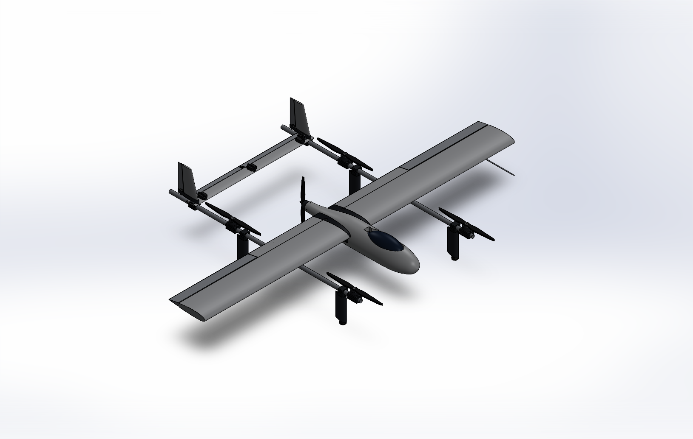

# CAPSTONE Design–Build–Fly: Lift + Cruise VTOL (student capstone)

A hybrid VTOL with four vertical lift rotors for takeoff and landing, and a pusher prop and fixed wing for cruise. The lift rotors stop in cruise. The aircraft is built and flight-tested on a **fixed $2,000 budget** (hardware, spares, test gear, tax and shipping) by **2027-04-30**. UC Berkeley capstone, four-person team.



## Status (2026-11-04)

Design phase, baseline C0 **v0.4.0** (wing re-sized on the aero package's CL_max, CAD rev B with every fastener, drawings rev D, final 2-D CFD and re-run FEA, thermal analysis, ArduPlane SITL). Nothing has been built or flown yet, so there is no measured thrust, temperature or flight data; each chapter of the review lists what the team still has to measure.

> **Two models of the same aircraft.** The SOLIDWORKS model (`cad/`, v0.4.0) drives the review, drawings and build manual. The Autodesk Fusion model with the hardware schedule, tolerances and joints (`fusion/`, `inventory/fusion/`) and the inventory overview were built from v0.3.1 and have not yet been migrated to v0.4.0. Until then the inventory builders read a frozen copy of their v0.3.1 inputs in `inventory/v031/` (parameters, meshes, BOM, sizing results), so they keep producing the published page.

## What to open

There are five interactive outputs. The first three are about the real aircraft, the fourth is a demonstration only, and the fifth compares literature concepts against the C0 envelope.

**Open online, no download:** [Inventory & Electrical Overview](https://claude.ai/artifact/C6JEuXWN4B4Aoay5zHU3Pg) (public, view only). Links to the other pages are under [Published versions](#published-versions-claude-artifacts).

### 1. Design review and companion documents (Dillon Alcouffe: design, CAD and analysis)

**[`VTOL-Review.html`](VTOL-Review.html)** is the engineering design review (DBF-RPT-001, issue 3) and the main project overview. Download it and double-click; it is one self-contained report in three parts (the decision, the design, build and fly), one chapter at a time, with interactive charts, animated CFD flow views, a rotatable SOLIDWORKS model and links to the companion documents. Every number cites a repo file, a shown formula, or a URL with the date checked. It is generated by `node review/build.mjs`; never hand-edit numbers into it.

| Document | Open |
|---|---|
| Design review DBF-RPT-001, issue 3 | [`VTOL-Review.html`](VTOL-Review.html) |
| Build manual DBF-MAN-001 (14 work packages, step by step) | [`build-manual.html`](build-manual.html) · source [`docs/build/BUILD-MANUAL.md`](docs/build/BUILD-MANUAL.md) |
| Test and evaluation plan DBF-TP-001 | [`test-plan.html`](test-plan.html) · source [`docs/test/TEST-PLAN.md`](docs/test/TEST-PLAN.md) |
| Flight software setup DBF-SW-001 | [`flight-software.html`](flight-software.html) · source [`firmware/README.md`](firmware/README.md) |
| Hot-wire templates (1:1) | [`templates.html`](templates.html) |
| Drawing set DBF-DRW-001 | [`cad/drawings/DBF-DRW-001.PDF`](cad/drawings/DBF-DRW-001.PDF) |

### 2. 3D CAD viewer (inside the review)

The review embeds a rotatable model of the SOLIDWORKS assembly (rev B: 75 part files, 397 components including every screw, nut, washer and insert). `cad/ExportMesh.cs` exports each part as STL (`cad/mesh/`, with colour and description in `meta.json`), and `review/mesh.mjs` packs them into the page. Static renders are in `cad/images/`, and the drawing set is `cad/drawings/DBF-DRW-001.PDF`.

### 3. Inventory & electrical overview (Tristan Hottier: inventory and electrical)

**[`Inventory-Overview.html`](Inventory-Overview.html)** (DBF-INV-001) is the project overview from the purchasing, physical-parts and electrical side. It is built like the design review, from the v0.3.1 snapshot of the same sources (`inventory/v031/`), and has ten sections. **Open it online:** https://claude.ai/artifact/C6JEuXWN4B4Aoay5zHU3Pg (public, view only, no Claude account needed).

| § | Section | What it covers |
|---|---|---|
| 1 | Overview | Spend vs the $2,000 cap, crash reserve, proposed additions, worst electrical conflict, status by kit, open decisions |
| 2 | 3D model | The SOLIDWORKS parts coloured by inventory status, plus the avionics, ESCs, servos, wire runs and the proposed wheels (each layer can be switched off); exploded view, isolate by kit, click any part, component or wire for its card. Below it, the full-detail Autodesk Fusion model with all 613 hardware pieces, the servos and linkages, and the wheel blocks; click a fastener group for its joint card |
| 3 | Electrical | Power and signal trees, flight-controller output and port map, power budget, ratings conflicts and actions |
| 4 | Wiring & tests | Wiring blueprint DBF-ELE-001 (every wire pin to pin, with the wing and boom breakdown joints), wire schedule, wire to buy by gauge, harness by joint, electrical test plan |
| 5 | Inventory | Every stock line (40 buy, 21 make, 2 Nautical Wings, 4 proposed): search, filters, sortable |
| 6 | Budget & orders | Spend by vendor and category, goods → tax → shipping → reserve, proposed additions kept separate, one order card per vendor |
| 7 | Fabrication & kits | What the team makes, from which stock line, by which process; cut lists; kit bins K1–K7; wheeled landing-gear proposal; print fits, tolerance stack-ups and calibration coupons |
| 8 | Nautical Wings props | Sponsorship status, a ready-to-send message to NWA, spec sheet, budget effect, acceptance tests |
| 9 | Receiving & storage | Receiving checklist, LiPo storage, bin locations |
| 10 | Alternative designs | The three least experimental literature concepts (wingtip cruise propellers, boundary-layer-ingesting pusher, aligned faired stopped rotors) developed into variants of C0: side-by-side metrics and charts, then a tab per variant with its bottom line, key numbers, Fusion 3D model (new parts highlighted, click for the inventory line), inventory lines vs C0 (status chips), budget, hardware delta and the full design note. Built from `concepts/variants/*`; a variant's 3D appears when its `fusion/variant_manifest.json` lands and the page is rebuilt (`node inventory/build_overview.mjs`) |

**Live inventory:** the editable copy is the Google Sheet [DBF Inventory (DBF-INV-001)](https://docs.google.com/spreadsheets/d/1nKiNBmtv2FeFGMaZjcKlNWKAuCMhC6uzteGTA2Iy9WE/edit). Budget totals and kit counts are formulas, so they update as quantities and statuses change. It is private: ask Tristan for access. The page shows a snapshot of it from the date in its header.

**Electrical design:** [`docs/research/electrical-architecture.md`](docs/research/electrical-architecture.md) with the machine-readable component list, wire list and connectors in `inventory/electrical/`. Placements and lengths are estimates until the harness is built. Open conflicts the team must resolve on the bench: lift motors at full throttle can draw up to 133 A against the 90 A current sensor and the motors' 26 A/30 s limit (cap lift throttle), and the transition current exceeds the XT90S continuous rating.

**Landing gear (proposal):** 3 in wheels on the four existing legs, so the aircraft can land vertically or roll in as a fixed wing. Pusher ground clearance rises from 36 to 84 mm (EST), the leg length is unchanged, and the parts cost $57.82 with tax, not yet in committed spend.

**Fusion model (full detail):** the aircraft rebuilt in Autodesk Fusion by script, down to every screw, washer, nut, insert, servo, pushrod, clevis and hinge, with the wheel axle blocks and toleranced holes in the printed parts. It is saved in Fusion (project DBF-VTOL, document "VTOL C0 full"); the STEP file, Fusion archive, meshes and renders are in `inventory/fusion/`, and the build scripts are in `fusion/`. The interference check left no unintended overlaps (`fusion/interference_report.json`). The assembly is constrained: 5 rigid groups, 29 joints (24 revolute: control surfaces, servo arms, pushrods, props, wheels; 5 sliders for the transport breakdown) and 5 servo-to-surface motion links (`fusion/build_joints_fusion.py`, `inventory/fusion/kinematics/kinematics.json` with the exact four-bar tables). Rendered animations of the servos driving the ailerons, elevator and rudders, the props, the wheels and the breakdown are in [`inventory/fusion/animations/`](inventory/fusion/animations/README.md); the page's Fusion viewer animates the same motion live (roll, pitch and yaw sliders, spin props, roll wheels, breakdown). Every joint was swept through its full range with no rigid collisions left: the wing panels got trailing-edge coves and pushrod exit slots, and the elevator, tail saddle, rudder horns and battery pocket got reliefs ([`fusion/motion_clearance.md`](fusion/motion_clearance.md)). Breakdown order: canopy, H-tail, then the wing panels. The hardware schedule is [`docs/research/hardware-schedule.md`](docs/research/hardware-schedule.md) with `inventory/hardware/hardware.json` and `mechanisms.json`.

**Print tolerances:** [`docs/research/tolerance-analysis.md`](docs/research/tolerance-analysis.md) and `inventory/hardware/tolerances.json`: 39 fits (7 fail and 9 are marginal as drawn) and 11 stack-ups. Print the calibration coupons first and size the joiner sockets and clamp bores to the measured tubes. The printer is assumed (the repo names none).

**Nautical Wings carbon props:** the Nautical Wings Aerospace founders offered in person to sponsor the team (team-reported, October 2026); the sponsorship rules still need confirming in writing, and §8 has the message to send. The props would replace the six JeeFly 1755 lift props and three APC 14x8.5EP pushers, which stay on hold as the fallback. If the props are free, the reserve rises from $102.08 to $186.05 (EST: no shipping or import cost). Research and spec sheet: [`docs/research/nautical-wings-props.md`](docs/research/nautical-wings-props.md).

### 4. 3D flight simulator (browser game)

A browser flight game built with three.js, where you fly a lift + cruise eVTOL: power on, auto takeoff to a hover, throttle up the pusher until the wing takes the load and the rotors stop, then auto land. It has a primary flight display, a rotor-vs-wing lift split bar, battery and endurance readouts, motor-failure injection, wind, day/dusk/night, four camera modes, keyboard and touch controls, and a guided first flight.

> **It is not an engineering tool.** It flies a notional full-scale **8-lift** eVTOL (2,200 kg, 13 m span, per `sim/src/config.js`), not the C0 4-lift baseline, and its numbers are not tied to `analysis/`. Nothing in the design review depends on it.

Source and run instructions: [`sim/`](sim/README.md) (needs a local web server, e.g. `python -m http.server` inside `sim/`).

### 5. Concept models (James Guymon: concept exploration)

**[`Concept-Models.html`](Concept-Models.html)** shows eleven VTOL concepts from the literature as interactive 3D models built on the C0 envelope, so they compare like for like. They cover wingtip props, a boundary-layer-ingesting pusher, parked and faired lift rotors, a tiltrotor, a blended wing, a tiltwing, a tailsitter, a box wing, fan-in-wing and a cross-flow fan. A0 is C0 itself, placed from `cad/params.txt` and `analysis/results.json`.

You can orbit any model and scrub or play the hover-to-cruise transition: rotors tilt, the wing pivots and lift rotors park. Toggles show the battery and the 3 m span limit. Each model reports its span, overall width, motor count, tilt mechanisms and largest part, plus one quoted literature claim with its source (checked 2026-10-21).

> **These are illustrative models, not CAD.** Only A0 follows the CAD placements. The other concepts reuse C0's parts and estimate their own proportions (EST), and none of them is sized.

Download and double-click the file. It needs web fonts and the three.js library from a CDN. Sources are in `concepts/` (`concepts.json`, `models.js`, `build.mjs`).

### Published versions (Claude artifacts)

Every page published as a Claude artifact from the team account. Public pages open for anyone with the link. A private page opens only for the team account until someone switches it to "Anyone with the link" in its Share menu; "—" means the access has not been checked.

**Project pages**

| Page | What it is | In the repo | Link | Access |
|---|---|---|---|---|
| Lift + Cruise VTOL Review | The design review (§1 above), as published on 2026-10-19 (v0.3.1); the repo file is the current v0.4.0 issue | `VTOL-Review.html` | https://claude.ai/artifact/5VFFp3Xv1u88pdJkyqS6dd | Public |
| DBF Inventory Overview | Inventory and electrical overview, Fusion model with all hardware, alternative designs (§3 above) | `Inventory-Overview.html` | https://claude.ai/artifact/C6JEuXWN4B4Aoay5zHU3Pg | Public |
| Lift + Cruise VTOL Sim | Browser flight game (§4 above) | `sim/` | https://claude.ai/artifact/221H8qjqH89NDempeZCqnT | Public |
| Concept Models | Eleven literature concepts as 3D models on the C0 envelope (§5 above) | `Concept-Models.html` | https://claude.ai/artifact/RmtnqVwQwzGtr5uR8NeNmD | — |
| VTOL Concept Atlas | Atlas of VTOL concepts | — | https://claude.ai/artifact/MUwcV6DA63V6CELbSu1nuU | — |
| Lift+Cruise VTOL — Phase 0–1 Review | Slide deck for the phase 0–1 review | — | https://claude.ai/artifact/W3H44ZixNDq3kHi9U3G4xY | Private |

**Team tracking**

| Page | What it is | Link | Access |
|---|---|---|---|
| Program Status Wall | Program status board | https://claude.ai/artifact/YaMQS7AE6VnxFRDzhsQBUN | — |
| Prediction Wall | Team prediction board | https://claude.ai/artifact/UotDJxRj63HPV1EKpi6q9H | — |

**Earlier exploration**

| Page | What it is | Link | Access |
|---|---|---|---|
| Tilt-Wing VTOL Design Report | Tilt-wing design report | https://claude.ai/artifact/P1anPjH3fBxVVbGBEpLHUg | — |
| Tilt-Wing Designer | Tilt-wing design tool | https://claude.ai/artifact/PQmwyLZZRQxfzAyzwcWGxL | — |

If a link doesn't open for you, use the repo file next to it where there is one. Access checked 2026-11-04.

## Current design (v0.4.0, 2026-10-21)

The numbers below come from `analysis/results.json` (sizing) and `analysis/aero/aero_results.json` (aerodynamics).

| | |
|---|---|
| Layout | C0: 4-lift twin-boom quadplane, H-tail with twin rudders on the booms, pusher on the pod; best of 29 configurations that keep the lift rotors stopped in cruise (`analysis/tradestudy.json`) |
| Span / wing | 2.4 m, 0.632 m² (chord 263 mm), NACA 2415, XPS foam core with packing-tape skin |
| MTOW | 6.43 kg (hard cap 25 kg; below the 8–15 kg working target, pending sign-off) |
| Lift / pusher | 5 × SunnySky X4110S 400KV; 17 in lift props; APC 14×8.5EP pusher |
| Hover / cruise | 888 W / 323 W at 20 m/s (aero build-up 297 W); hover T/W 1.95 on maker data |
| Energy | 2 × Ovonic 6S 6500 mAh LiPo; 13.1 min cruise available after 2 min hover + 20 % reserve (needs the printed leg fairings) |
| Aerodynamics | CD0 0.0427, L/D 8.3 at cruise; stall 12.05 m/s predicted (R11 ≤ 12, at the limit); neutral point 40.4 % MAC with the pod |
| Structure | 6061-T6 booms, spar sockets and a 0.76 m slip-fit joiner; joiner reserve factor 1.78 on yield at 4.5 g |
| CAD | SOLIDWORKS rev B: 75 part files, 397 components including every screw, nut, washer and insert; interference-checked |
| Avionics | CoreWing F405 Wing V2 + ArduPlane 4.7.2 stable QuadPlane; parameter file `firmware/vtol_c0.param` checked, SITL scenarios A–G pass |
| Budget | **$1,896.79 committed** (goods $1,620.67 + 10.25 % tax + $110 shipping estimate); **$103.21 reserve** |

Simulation results (FEA, modal, thermal, CFD) and the independent checks in `analysis/verify.py` are in the review's design chapters and `cad/sim/`, `analysis/aero/`, `analysis/thermal/`.

## Repository layout

| Path | What it is |
|---|---|
| `VTOL-Review.html`, `build-manual.html`, `test-plan.html`, `flight-software.html`, `templates.html` | The review and its companion pages (generated by `review/build.mjs`) |
| `review/` | Page sources (`src/`), companion-page renderer, mesh packer and build script |
| `docs/build/` | Build manual, cut / print / wiring lists, hot-wire template generator |
| `docs/test/` | Test plan, test matrix, flight test cards, data-reduction scripts |
| `firmware/` | ArduPlane parameter files, setup guide, checklists, parameter checker, SITL scripts and results |
| `analysis/aero/` | XFOIL, NeuralFoil, AVL, drag build-up and SU2 CFD (`run_all.py`) |
| `analysis/thermal/` | Thermal analysis |
| `docs/DESIGN-BASIS.md` | Requirements R1–R20 (Given vs Assumed), decisions log |
| `docs/research/` | Parts research with prices, URLs and dates; `hardware-spec.md` (fasteners and fits), `configurations.md` (trade-study literature), `aerodynamics.md`, `firmware.md`, plus the inventory, electrical, hardware-schedule and tolerance notes |
| `docs/purchasing/C0_BOM.csv` | Purchasing list grouped by vendor, with order-tracking columns |
| `docs/reference/` | Review house style and the lift + cruise reference configurations |
| `analysis/model.js` | Sizing model (formulas F1–F12). The page sliders run this same file |
| `analysis/sizing.mjs` | Concept sizing, geometry, CG, structures, BOM → `analysis/results.json` |
| `analysis/vlm.mjs` | Vortex-lattice aero check (lift slope, neutral point, span efficiency) → `aero.json` |
| `analysis/verify.py` | Independent re-derivation of every formula, the BOM, FEA vs hand and VLM vs sizing |
| `cad/` | SOLIDWORKS model generator, drawings, meshes, simulations and outputs. See [`cad/README.md`](cad/README.md) |
| `Inventory-Overview.html` | Inventory Czar overview (standalone; rebuilt by `inventory/build_overview.mjs`) |
| `docs/research/electrical-architecture.md` | Electrical architecture, pin map, power budget, wiring rules, test plan, landing-gear geometry |
| `inventory/electrical/` | Components with placements, wire list (routes, gauges, connectors) and proposed purchase lines |
| `inventory/` | Inventory master list (`inventory.csv`, `inventory.json`), its builder, the Google Sheet seed (`DBF-Inventory-sheet.csv`), a formatted offline workbook (`DBF-Inventory.xlsx`), the overview page sources and the sheet link (`sheet.json`) |
| `fusion/` | Autodesk Fusion build scripts (airframe, hardware, export) and the interference report |
| `inventory/fusion/` | Fusion exports: STEP, .f3d, per-part STL meshes with `manifest.json`, renders |
| `inventory/hardware/` | Hardware schedule (`hardware.json`), mechanisms, print tolerances, new purchase lines |
| `inventory/v031/` | Frozen v0.3.1 inputs the inventory builders read (params, meshes, BOM, sizing results, design basis) until the inventory is migrated to v0.4.0 |
| `concepts/variants/` | Alternative designs A1–A3: design notes, inventories, metrics and Fusion models |
| `sim/` | Browser flight game (three.js), copied from the published Sim artifact; not used by the engineering |
| `Concept-Models.html` | Literature concepts as 3D models on the C0 envelope (standalone; rebuilt by `concepts/build.mjs`) |
| `concepts/` | Concept text and sources (`concepts.json`), the 3D model builders (`models.js`) and the page build script |
| `PRODUCT.md`, `DESIGN.md` | Who the review is for, and its visual design system |

## Regenerate everything

```bash
node analysis/sizing.mjs        # sizing + BOM  -> analysis/results.json
node analysis/vlm.mjs           # aero check    -> analysis/aero.json
node analysis/export_bom.mjs    # purchasing    -> docs/purchasing/C0_BOM.csv
py -3 analysis/verify.py        # independent checks (expects "FAILED CHECKS: none")
node analysis/tradestudy.mjs    # 29-variant trade study -> analysis/tradestudy.json
py -3 analysis/aero/run_all.py  # aerodynamics and CFD -> analysis/aero/aero_results.json (--skip-cfd for the fast tools)
py -3 firmware/tools/check_params.py firmware/vtol_c0.param
node review/build.mjs           # review and companion pages
node inventory/build_inventory.mjs   # inventory     -> inventory/inventory.csv, inventory.json
python3 inventory/build_sheet.py     # sheet seed    -> inventory/DBF-Inventory.xlsx, DBF-Inventory-sheet.csv
node inventory/build_overview.mjs    # overview page -> Inventory-Overview.html (reads inventory/v031/, see Status)
node concepts/build.mjs              # concept models -> Concept-Models.html (reads cad/params.txt)
```

The CAD and simulations need SOLIDWORKS 2025 with Simulation on Windows:

```bash
powershell -ExecutionPolicy Bypass -File cad/build.ps1   # params -> parts, assembly, STEP, eDrawings, drawings, meshes
cad/Snap.exe <full path>/cad/model/VTOL_Concept.SLDASM <full path>/cad/images
cad/Sim.exe cad/params.txt cad/sim                      # FEA + modal + thermal -> cad/sim/results.txt
```

After a CAD change, run `node review/build.mjs` again so the page picks up the new renders and meshes.

## Working rules (from CLAUDE.md)

- Every number cites its source: a repo file, a formula shown in the review, or a URL with the date checked.
- Estimates are labelled `est`. Unknowns are shown as "—" and never invented.
- The review follows `docs/reference/REVIEW-STYLE.md`.
- Scope is the real aircraft; the browser flight simulator (`sim/`) is out of scope for engineering numbers.

## Open items for the team

These come from the review and the inventory overview; each review chapter also lists what the team still has to measure.

1. **Approve and order.** Client approval and Order A (test motors, packs, charger) by 2026-11-02.
2. **Flying site and legal path.** Ask UCPD/Risk Services by 2026-11-06 whether the capstone qualifies, and request Richmond Field Station.
3. **Thrust stand first.** Qualify every motor/ESC (tests T1–T6) before any flight; C0 has no hover motor-out tolerance.
4. **Nautical Wings sponsorship.** Send the message in inventory overview §8 to confirm the sponsorship rules in writing, with the spec sheet. Until then the retail props stay on hold.
5. **Electrical bench checks.** Cap lift throttle so each motor stays at or below 26 A on the thrust stand, and measure the servo-rail stall current (inventory overview §3–4).
6. **Landing gear.** Decide on the wheeled gear proposal (inventory overview §7). The Fusion model now has printed axle blocks for it.
7. **Cart totals.** Price shipping at checkout. If the reserve drops under $100: borrow a hot-wire cutter, then drop the spare motor, then the airspeed sensor.
8. **Flight build-up.** Follow the review's build-and-fly part and the test plan DBF-TP-001 (SITL → bench → tethered → free hover → partial → full transition → mission).
9. **Measure before printing.** The tube diameters, the X4110S bolt pattern and thread depth, the ES3005HV ear holes, the 300SL hub bore and the DUB248 thread are unknown; the joiner fit fails as drawn (docs/research/tolerance-analysis.md).
10. **Battery access.** The battery cannot be lifted out of the pod in the CAD (no hatch over it, the saddle covers its rear 17 mm); the pod needs a hatch or a top-loading change (fusion/motion_clearance.md).

11. **Rebuild the inventory side for v0.4.0.** The inventory overview, Google Sheet and Fusion model still use the v0.3.1 parameters and BOM ($1,897.92 committed); the v0.4.0 BOM is $1,896.79 committed.
